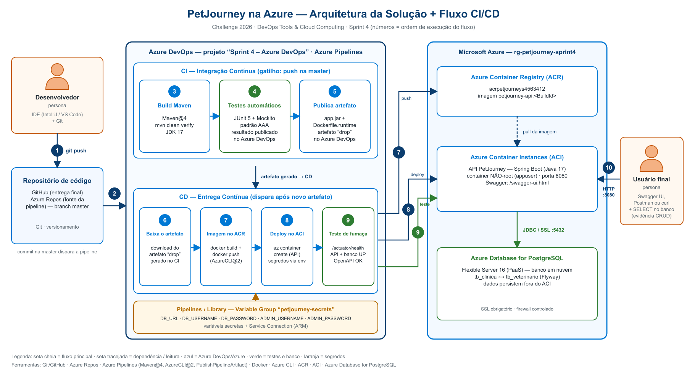

# PetJourney
### DevOps Tools & Cloud Computing · Sprint 4

API para gestão de clínicas veterinárias: clínicas, profissionais, tutores, pets, consultas, prontuários e medicamentos. O acesso usa JWT e perfis de administrador do sistema, administrador da clínica, veterinário e tutor.

| Integrante | RM | Turma |
|---|---|---|
| Felipe Wiclif Leal da Silva | 563901 | TDSPX |
| Deryk de Souza Queiroz | 563412 | TDSPX |
| Lucas Gonçalves Viana | 563254 | TDSPX |
| Vinicius Paschoeto da Silva | 563089 | TDSPX |

**Professor:** Joao Carlos Menk  
**Repositório:** [Wiclif06/Sprint4---Cloud](https://github.com/Wiclif06/Sprint4---Cloud)

## Tecnologias

Java 17, Spring Boot 3.5, Spring Security, Spring Data JPA, Flyway, PostgreSQL 16, Swagger/OpenAPI, JUnit 5, Mockito, Maven, Docker, Azure DevOps, Azure Container Registry e Azure Container Instances.

## Arquitetura



O banco usa Azure Database for PostgreSQL Flexible Server. Os dados ficam no serviço de banco, separados do container da API, e são preservados nos deploys. O Flyway aplica as migrações de `src/main/resources/db/migration`; o Hibernate valida o esquema na inicialização.

## CI/CD

A pipeline está em [azure-pipelines.yml](azure-pipelines.yml) e usa a branch `master`.

1. Um push na `master` dispara o CI.
2. O Maven compila a aplicação, executa os testes e gera `target/app.jar`.
3. O Azure DevOps publica os resultados dos testes e o artefato `drop`, com o JAR, os arquivos de runtime, os scripts e os checksums.
4. O CD baixa e verifica esse artefato, constrói a imagem e a publica no ACR com a tag do build.
5. O Azure CLI implanta a imagem no ACI.
6. A verificação final exige saúde `UP` da aplicação e do PostgreSQL, além da especificação OpenAPI disponível. Uma falha interrompe a execução.

## Configuração no Azure

**Pré-requisitos:** assinatura Azure, Azure CLI, Bash e Docker; agente do Azure Pipelines com Java 17, Maven, Docker, Azure CLI, curl e jq.

Em [scripts/env.sh](scripts/env.sh), configure região e nomes dos recursos antes do primeiro provisionamento. ACR e servidor PostgreSQL precisam de nomes disponíveis.

```bash
az login
bash scripts/provision.sh
```

O script solicita as credenciais do PostgreSQL e cria o grupo de recursos, ACR, PostgreSQL e regras de firewall. A conexão usa TLS (`sslmode=require`). O firewall permite conexões de serviços Azure e do IP da máquina que executou o script; se esse IP mudar, execute-o novamente.

No Azure DevOps:

- Projeto **Sprint 4 – Azure DevOps**, **Private**, **Git**, processo **Scrum ou Agile**.
- Descrição: **Projeto para entrega da Sprint 4 do professor Joao Carlos Menk**, seguida dos integrantes, RMs e turmas.
- Professor com acesso **Basic** e permissão de administrador do projeto. E-mails informados: `profjoao.menk@fiap.com.br` / `pf0841@fiap.com.br`.
- Service Connection Azure Resource Manager chamada `sc-azure-petjourney`, com acesso ao grupo de recursos.
- Variable Group `petjourney-secrets`, autorizado para esta pipeline, com as variáveis abaixo.
- Ambiente `petjourney-aci`, autorizado para a pipeline e sem aprovação manual de deploy.
- Pipeline conectada ao repositório da aplicação, usando `/azure-pipelines.yml` na branch `master`.

| Variável | Conteúdo |
|---|---|
| `DB_URL` | URL JDBC exibida pelo provisionamento |
| `DB_USERNAME` | Administrador do PostgreSQL |
| `DB_PASSWORD` | Senha do PostgreSQL |
| `ADMIN_USERNAME` | Login do administrador do sistema |
| `ADMIN_PASSWORD` | Senha inicial desse administrador, de 12 a 72 caracteres ASCII |

**Marque as cinco variáveis como secret.** Elas são repassadas ao ACI como variáveis protegidas. O administrador da aplicação é criado no primeiro início; reinicializações preservam sua conta e senha. Alterar `ADMIN_PASSWORD` depois disso não redefine uma conta existente.

Se o repositório ainda usa `main`, crie `master` com o conteúdo final e publique-a no repositório conectado à pipeline:

```bash
git switch -c master
git push -u origin master
```

Quando Azure Repos for usado como origem da pipeline, mantenha a mesma versão também no GitHub da entrega.

## Build e testes

```bash
mvn clean verify
```

Os testes cobrem validação de DTOs, mapeamentos, tratamento de erros, permissões e operações dos serviços de clínica e veterinário, além da criação inicial do administrador. Os testes unitários não exigem banco.

Para construir a imagem localmente:

```bash
docker build -t petjourney-api .
```

O Dockerfile também executa os testes. A imagem final roda como usuário sem privilégios de root.

## Acesso à aplicação

Consulte o FQDN do ACI:

```bash
source scripts/env.sh
az container show -g "$RESOURCE_GROUP" -n "$ACI_API_NAME" --query ipAddress.fqdn -o tsv
```

| Recurso | Endereço |
|---|---|
| Swagger | `http://<FQDN>:8080/swagger-ui.html` |
| OpenAPI | `http://<FQDN>:8080/api-docs` |
| Saúde da aplicação e banco | `http://<FQDN>:8080/actuator/health` |

O endpoint de saúde retorna apenas o estado, sem dados internos.

## CRUD e persistência

No Swagger, execute `POST /auth/login` com as credenciais do administrador e use o token em **Authorize**.

| Operação | Clínica | Veterinário |
|---|---|---|
| Criar | `POST /clinics` | `POST /veterinarians` |
| Consultar | `GET /clinics/{id}` | `GET /veterinarians/{id}` |
| Atualizar | `PUT /clinics/{id}` | `PUT /veterinarians/{id}` |
| Excluir | `DELETE /clinics/{id}` | `DELETE /veterinarians/{id}` |

O CRUD de clínica exige `ADMIN_SISTEMA`. Para gerenciar veterinários, crie um administrador da clínica em `POST /system/clinics/{clinicId}/admins` e autentique-se com essa conta. O `clinicId` deve corresponder à clínica desse administrador. Para cadastro sem envio de e-mail, use `email: null` no veterinário.

As exclusões são lógicas: o registro permanece com `active = false`. Execute as consultas de [docs/consultas.sql](docs/consultas.sql) no banco em nuvem após cada operação para verificar os dados. Repita as consultas após outro deploy para conferir a persistência.

